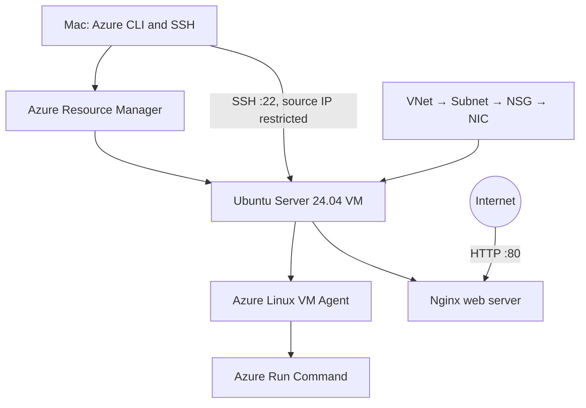

# Azure Linux VM Administration and Troubleshooting with Azure CLI

> **Project 03 in a cloud engineering learning portfolio**  
> Status: Planned  
> Platform: Microsoft Azure  
> Region: `centralus`

This hands-on lab builds on an existing Ubuntu Server 24.04 virtual machine and its network from Projects 01 and 02. It practices day-to-day VM operations through Azure CLI, including health checks, remote command execution, boot diagnostics, network inspection, and cost-aware lifecycle management.

The lab reuses the existing VM. It does not create a second VM.

## Learning objectives

By the end of the lab, I expect to be able to:

- Inspect a VM's power state, instance view, and Azure Linux VM Agent status.
- Run Linux commands remotely with Azure Run Command, including when SSH is unavailable.
- Build and run a reusable health-check script.
- Enable boot diagnostics and retrieve the serial boot log.
- Inspect the VM's managed OS disk and network security rules.
- Add and verify Azure resource tags.
- Deallocate and restart a VM, then verify the service is reachable.
- Explain which resources can continue to incur charges after deallocation.

## Background and prerequisites

This lab assumes Projects 01 and 02 are complete and the Project 02 VM still exists. If it was destroyed, redeploy it before continuing.

| Resource | Expected name |
| --- | --- |
| Resource group | `rg-azure-linux-lab` |
| Virtual machine | `vm-ubuntu-linux-lab` |
| Network security group | `nsg-linux-lab` |
| Region | `centralus` |

You will also need:

- A Mac with Azure CLI and Terraform installed.
- An Azure subscription with permission to inspect and operate the VM and related resources.
- An authenticated Azure CLI session (`az login`).
- The Project 02 repository at `~/Azure-Projects/azure-linux-vm-lab`.
- The SSH private key kept locally at `~/.ssh/azure_lab_ed25519` (never commit it).

## Architecture



Run Command uses the VM Agent to execute scripts inside the guest. It can help with administration when SSH is unavailable, provided the VM Agent and required connectivity are healthy. Run Command scripts are non-interactive and output is limited to the last 4,096 bytes. See [Microsoft's Run Command documentation](https://learn.microsoft.com/en-us/azure/virtual-machines/linux/run-command).

## Lab workflow

### 1. Set names and verify the VM

```bash
export RG="rg-azure-linux-lab"
export VM="vm-ubuntu-linux-lab"

az account show --output table

az vm show \
  --resource-group "$RG" \
  --name "$VM" \
  --output table

az vm get-instance-view \
  --resource-group "$RG" \
  --name "$VM" \
  --query "instanceView.statuses[].displayStatus" \
  --output table

az vm show \
  --resource-group "$RG" \
  --name "$VM" \
  --show-details \
  --output table
```

Stop if Azure cannot find the VM; complete Project 02 first.

### 2. Check the Azure Linux VM Agent

```bash
az vm get-instance-view \
  --resource-group "$RG" \
  --name "$VM" \
  --query "instanceView.vmAgent.statuses[].displayStatus" \
  --output table
```

A ready agent is needed for Run Command. If the VM is running but the agent is not ready, investigate the guest agent and its connectivity before relying on remote execution.

### 3. Run a first remote health check

```bash
az vm run-command invoke \
  --resource-group "$RG" \
  --name "$VM" \
  --command-id RunShellScript \
  --scripts "hostname; uptime; free -h; df -h"
```

The output should include the hostname, uptime, memory, and filesystem usage. Run Command needs outbound connectivity to return output and runs scripts non-interactively.

### 4. Create a reusable health-check script

From the Project 02 directory:

```bash
cd ~/Azure-Projects/azure-linux-vm-lab

cat > vm-healthcheck.sh <<'SCRIPT'
#!/usr/bin/env bash

set +e

echo "=================================="
echo "AZURE UBUNTU VM HEALTH CHECK"
echo "=================================="

echo ""
echo "1. HOSTNAME"
hostnamectl --static 2>/dev/null || hostname

echo ""
echo "2. SYSTEM UPTIME"
uptime

echo ""
echo "3. MEMORY"
free -h

echo ""
echo "4. ROOT FILESYSTEM"
df -h /

echo ""
echo "5. NGINX SERVICE"
if systemctl is-active --quiet nginx; then
  echo "NGINX STATUS: ACTIVE"
else
  echo "NGINX STATUS: NOT ACTIVE"
fi

echo ""
echo "6. NGINX CONFIGURATION"
nginx -t 2>&1 || true

echo ""
echo "7. LISTENING PORTS 22 AND 80"
ss -lntp | grep -E ':(22|80)[[:space:]]' || true

echo ""
echo "8. RECENT NGINX LOGS"
journalctl -u nginx -n 8 --no-pager || true

echo ""
echo "=================================="
echo "HEALTH CHECK COMPLETE"
echo "=================================="
SCRIPT

chmod +x vm-healthcheck.sh
```

Execute the script through Azure Run Command:

```bash
az vm run-command invoke \
  --resource-group "$RG" \
  --name "$VM" \
  --command-id RunShellScript \
  --scripts "$(cat vm-healthcheck.sh)" \
  --query "value[0].message" \
  --output tsv
```

### 5. Enable boot diagnostics and retrieve the boot log

```bash
az vm boot-diagnostics enable \
  --resource-group "$RG" \
  --name "$VM"

az vm boot-diagnostics get-boot-log \
  --resource-group "$RG" \
  --name "$VM" \
  --output tsv | tail -n 40
```

Boot diagnostics can help investigate startup problems. See [Azure CLI boot diagnostics](https://learn.microsoft.com/en-us/cli/azure/vm/boot-diagnostics).

### 6. Inspect the OS disk

```bash
export OS_DISK_ID="$(az vm show \
  --resource-group "$RG" \
  --name "$VM" \
  --query "storageProfile.osDisk.managedDisk.id" \
  --output tsv)"

az disk show \
  --ids "$OS_DISK_ID" \
  --query "{Name:name, SizeGB:diskSizeGb, SKU:sku.name, State:diskState}" \
  --output table
```

Deallocating a VM releases compute capacity; it does not delete its managed disk. Disk storage can continue to incur charges.

### 7. Inspect NSG rules and keep SSH restricted

```bash
az network nsg list \
  --resource-group "$RG" \
  --output table

az network nsg rule list \
  --resource-group "$RG" \
  --nsg-name nsg-linux-lab \
  --query "[].{Name:name,Priority:priority,Port:destinationPortRange,Source:sourceAddressPrefix,Access:access}" \
  --output table
```

Verify that SSH (TCP 22) is limited to your current public IP and that HTTP (TCP 80) is allowed for the web-server test. Do not open SSH to the entire internet as a troubleshooting shortcut.

If your public IP has changed, identify the actual SSH rule name from the output and update that rule:

```bash
export MY_IP="$(curl -4 -s https://ifconfig.me)"

az network nsg rule update \
  --resource-group "$RG" \
  --nsg-name nsg-linux-lab \
  --name "<SSH-RULE-NAME>" \
  --source-address-prefixes "${MY_IP}/32"
```

Replace `<SSH-RULE-NAME>` with the rule's real name. Verify the rule after updating it.

### 8. Add project tags

```bash
export VM_ID="$(az vm show \
  --resource-group "$RG" \
  --name "$VM" \
  --query id \
  --output tsv)"

az tag update \
  --resource-id "$VM_ID" \
  --operation Merge \
  --tags Project=AzureCloudEngineeringLab Environment=Training ManagedBy=AzureCLI

az resource show \
  --ids "$VM_ID" \
  --query tags \
  --output json
```

### 9. Deallocate, start, and verify the VM

A VM that is stopped but still allocated can continue to incur compute charges. Deallocation releases the compute resources, while storage and some networking resources may still incur charges. Review [Microsoft's compute cost guidance](https://learn.microsoft.com/en-us/cloud-computing/finops/best-practices/compute).

Deallocate the VM after completing the checks:

```bash
az vm deallocate \
  --resource-group "$RG" \
  --name "$VM"

az vm get-instance-view \
  --resource-group "$RG" \
  --name "$VM" \
  --query "instanceView.statuses[].displayStatus" \
  --output table
```

Start it again and retrieve its current IP addresses:

```bash
az vm start \
  --resource-group "$RG" \
  --name "$VM"

az vm show \
  --resource-group "$RG" \
  --name "$VM" \
  --show-details \
  --query "{PowerState:powerState,PublicIP:publicIps,PrivateIP:privateIps}" \
  --output table
```

Test the site using the current public IP shown by Azure:

```bash
curl -I "http://YOUR_AZURE_PUBLIC_IP"
```

A successful response should show an HTTP success status such as `200 OK`. If SSH is needed, use the current public IP:

```bash
ssh -i ~/.ssh/azure_lab_ed25519 azureadmin@YOUR_AZURE_PUBLIC_IP
```

### 10. Troubleshooting notes

| Symptom | Checks |
| --- | --- |
| VM not found | Confirm the subscription, resource group, VM name, and whether Project 02 was destroyed. |
| Run Command fails | Check VM power state, VM Agent readiness, and outbound connectivity. |
| SSH times out | Check current public IP, NSG rule source, public IP association, and SSH service. |
| SSH reports `Permission denied (publickey)` | Confirm the admin username and that the private key matches the public key configured on the VM. |
| Nginx is inactive | Use Run Command to inspect and restart Nginx; inspect its service logs. |
| Website does not load | Check VM state, current public IP, Nginx service, and inbound HTTP rule. |
| Boot log is unavailable | Confirm boot diagnostics are enabled and retry after Azure has had time to publish diagnostic output. |

Restart Nginx without SSH:

```bash
az vm run-command invoke \
  --resource-group "$RG" \
  --name "$VM" \
  --command-id RunShellScript \
  --scripts "systemctl restart nginx && systemctl is-active nginx"
```

### 11. Git and cleanup

Commit the reusable script from the Project 02 repository:

```bash
git status
git add vm-healthcheck.sh
git commit -m "Add Azure Linux VM health check automation"
```

If the folder is not yet a Git repository, initialize it with `git init` before adding the file. Never commit SSH private keys, credentials, Terraform state, or sensitive `.tfvars` files.

When you no longer need the Project 02 environment, use Terraform from its project directory so Terraform can remove the resources it manages:

```bash
cd ~/Azure-Projects/azure-linux-vm-lab
terraform plan -destroy
terraform destroy
```

Review the destroy plan before confirming. Deallocating the VM is not the same as destroying the Terraform-managed resources.

## Practical challenge

Complete all three tasks without opening an SSH session:

1. **Remote administration:** Retrieve hostname, uptime, memory, disk usage, and Nginx status with Run Command.
2. **Troubleshooting:** Restart Nginx with Run Command and confirm it is active.
3. **Lifecycle management:** Deallocate the VM, verify the state, start it again, and confirm the website responds.

## Progress and evidence

- [ ] Confirm the Project 02 VM exists and is running.
- [ ] Verify VM Agent readiness.
- [ ] Run the basic remote command.
- [ ] Create and execute `vm-healthcheck.sh`.
- [ ] Enable boot diagnostics and retrieve the log.
- [ ] Inspect the OS disk and NSG rules.
- [ ] Add and verify tags.
- [ ] Deallocate and restart the VM; verify HTTP response.
- [ ] Complete the three practical challenges.
- [ ] Commit the health-check script.
- [ ] Save sanitized evidence (no secrets, private keys, or sensitive account details).

Suggested evidence:

1. Azure CLI output showing VM running status.
2. The `vm-healthcheck.sh` script.
3. Run Command output from the health check.
4. Boot diagnostics enabled and boot log retrieved.
5. CLI output showing deallocation and successful restart.

## Skills demonstrated

Azure CLI · Azure Virtual Machines · Linux administration · Azure VM Agent · Run Command · Bash scripting · Nginx · Boot diagnostics · NSG inspection · Managed disks · Resource tagging · VM lifecycle management · Cost awareness · Terraform workflow · Troubleshooting

## Next project

Project 04 introduces Microsoft Entra ID and Azure RBAC: identity fundamentals, subscription and resource scopes, role assignments, least privilege, and access verification with Azure CLI.

## References

- [Run scripts in a Linux VM in Azure using Run Command](https://learn.microsoft.com/en-us/azure/virtual-machines/linux/run-command)
- [Manage Linux VMs with the Azure CLI](https://learn.microsoft.com/en-us/azure/virtual-machines/linux/tutorial-manage-vm)
- [Azure CLI: VM boot diagnostics](https://learn.microsoft.com/en-us/cli/azure/vm/boot-diagnostics)
- [Troubleshoot SSH connections to Azure Linux VMs](https://learn.microsoft.com/en-us/troubleshoot/azure/virtual-machines/linux/troubleshoot-ssh-connection)
- [FinOps best practices for compute](https://learn.microsoft.com/en-us/cloud-computing/finops/best-practices/compute)
